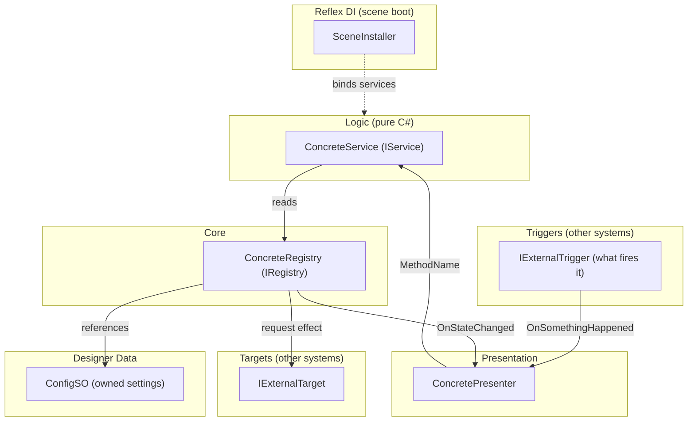

# <System or Scope Name> – Architecture

*One-sentence summary: what this system or scope does in the game, and which parts the diagram covers.*

Last verified against source: YYYY-MM-DD.

---

## Architecture Diagram

**How to read it:** solid arrows show calls or events at runtime. Dotted arrows show DI wiring, limits from constants, or configuration references. Each box is described below.

---

## Responsibilities

### 1. <Group Name>

| Part | Responsibility |
| :--- | :--- |
| `TypeName` | What it owns, when it acts, what it hands off, and what it does not own. |

### 2. <Group Name>

| Part | Responsibility |
| :--- | :--- |
| `TypeName` | ... |

---

## Key Rules at a Glance

- <Invariant a human must respect, for example hierarchy, naming, or caps.>
- <Invariant about data mutation or ownership.>
