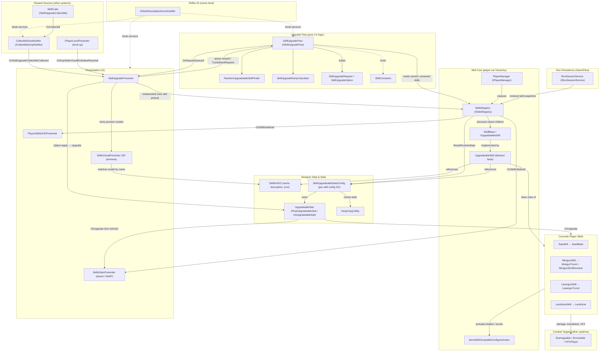

# Skills System – Architecture

*An overview of how the player's car gets, upgrades, uses, and displays its skills (Saw, Minigun, Lasergun, Landmine), with what each part is responsible for.*

Last verified against source: 2026-11-21.

---

## Architecture Diagram

**How to read it:** solid arrows show calls or events at runtime. Dotted arrows show DI wiring or limits from constants. Each box is described below.

---

## Responsibilities

### 1. Reflex DI (scene boot)

| Part | Responsibility |
| :--- | :--- |
| `DefaultGameplaySceneInstaller` | Registers the skills services for the gameplay scene: `SkillUpgradeFlow` as `ISkillUpgradeFlow`, `SkillsVisualPresenter`, `PlayerSkillsHUDPresenter`, `SkillsStatsPresenter`, `CollectibleDropNotifier`, and the `SkillUpgradePresenter` it finds under the player. This keeps every dependency explicit, with no singletons or scene searches. |

### 2. Reward Sources (other systems)

| Part | Responsibility |
| :--- | :--- |
| `IPlayerLevelPresenter` | Fires `OnExpSliderVisualEndValueReached` when the EXP bar fills. This is the level-up reward trigger. The Skills system does not own level math. |
| `SkillCrate` | A pooled pickup on the map. When the player touches it, it raises `OnCollected` and returns itself to the pool. It counts as an `ISkillUpgradeCollectible`. |
| `CollectibleDropNotifier` | Passes crate pickups on as `OnSkillUpgradeCollectibleCollected`, so the UI can queue a stat-upgrade reward. |

### 3. Run Persistence (GameFlow)

| Part | Responsibility |
| :--- | :--- |
| `RunSessionService` | Captures owned skills and their stat values (`SavedSkillSnapshot`) when the run moves to the next tier. At the start of the next stage, it gives them back so `SkillsRegistry` can restore the loadout instead of starting from scratch. |

### 4. Upgrade Flow (pure C# logic)

| Part | Responsibility |
| :--- | :--- |
| `SkillUpgradeFlow` | The **reward queue**. It stores lightweight tokens ("new skill" or "stat upgrade") and works out the actual content **only when a token is taken from the queue (just-in-time)**. That way a skill unlocked a moment ago can already be upgraded by the next reward. It also reserves pending new-skill slots so a burst of level-ups can't push you past the 3-skill cap. If a new skill isn't possible (cap reached or none left), it gives a stat upgrade instead. Skills with no upgradeable stats left are skipped. |
| `RandomUpgradeableSkillFinder` | Picks a random **owned** skill that still has at least one stat that can be upgraded. |
| `SkillUpgradeRarityCalculator` | Labels a rolled upgrade value as Common, Rare (≥ 50% of the roll range), or UltraRare (≥ 80%). The label is **visual only**, and a stat can override it manually in the Inspector. |
| `SkillUpgradeRequest` / `SkillUpgradeOption` | Data carried from the flow to the UI. The request holds either up to 2 new-skill choices or a target skill with up to 3 upgrade options. Each option holds display text, rarity, stat icon, and an `Apply` callback. |
| `SkillConstants` | Shared limits and tuning: max 3 active skills, 2 new-skill choices, 3 upgrade options, rarity thresholds, and Saw knockback bounds. |

### 5. Skill Core (player car hierarchy)

| Part | Responsibility |
| :--- | :--- |
| `PlayerManager` | Entry point to the player. It exposes `SkillsRegistry` to other systems through `IPlayerManager`. |
| `SkillsRegistry` | The **list of every skill the car could have**. In `Awake`, it finds skill components on its **direct children**. In `Start`, it resets every config to fresh runtime copies, then either restores skills saved by `RunSessionService` or activates the first child (`Skills[0]`) as the starting skill. It tracks owned and unowned counts, and raises `OnSkillInitialized` whenever a skill is unlocked. |
| `ISkillBase` / `IUpgradeableSkill` | Contracts. Every skill exposes its `SkillInfoSO` and can be initialized. Upgradeable skills also expose their stats config and `CanBeUpgraded()`. |
| `UpgradeableSkill` | Abstract base for concrete skills. It holds the config reference. Unlocking the skill activates its GameObject. It reports "can be upgraded" while any stat still has room to grow. |
| `ItemsWithScriptableConfigsActivator` | A helper that switches on child items (saw blades, turrets) and gives them their config: the first one, a random one, or enough to reach a target count (for example, `NumberOfTurrets`). |
| `RandomUninitializedSkillsInitializator` | Helper that unlocks a random unowned skill directly. Gameplay code doesn't call it at the moment; new skills are picked by the player through the 2-card choice. |

### 6. Concrete Player Skills

| Part | Responsibility |
| :--- | :--- |
| `SawSkill` → `SawBlade` | A melee blade spinning around the car. It spins faster while steering or drifting and hits each enemy on a per-enemy cooldown. It pushes enemies forward with knockback limited to 1.2–3.5 m. The blade count is fixed at 1. |
| `MinigunSkill` → `MinigunTurret` | Turrets that sweep left and right and fire volleys down a glowing lane shown on the ground. `MinigunShotResolver` works out which enemies each shot hits (up to `1 + Piercing` targets, stopped by walls). Tracers fly at 70 m/s, and damage lands when the tracer arrives. |
| `LasergunSkill` → `LasergunTurret` | Turrets that find the nearest visible enemies, charge up, then fire laser beams at up to `NumberOfTargets` at once. The skill adds more turrets and targets when those stats are upgraded. |
| `LandmineSkill` → `Landmine` | Drops a mine on valid ground at a set interval. The mine explodes when an enemy steps on it, dealing area damage and pushing enemies away from the center. |

All concrete skills listen to their stats' `OnUpgrade` events, so an upgrade takes effect right away (for example, a new turret appears).

### 7. Designer Data & Stats

| Part | Responsibility |
| :--- | :--- |
| `SkillInfoSO` | Display identity of a skill: name, description, and 2D icon. The name is also used to match 3D preview models and saved snapshots. |
| `SkillUpgradeableStatsConfig` (per-skill SO, e.g. `SawSkillUpgradeableConfigSO`) | Holds a skill's balance stats. `ResetRuntimeState()` deep-copies them so **the ScriptableObject asset is never changed during play**. It lists stats that can still be upgraded (for rolling options) and all owned stats in a fixed order (for the stats panel). |
| `UpgradeableStat` (`FloatUpgradeableStat` / `IntUpgradeableStat`) | A single stat with its current value, min/max, upgrade roll range, unit, icon, and options: subtract mode, unlimited max, always use the minimum roll. `Upgrade()` changes the value, marks the stat as maxed when needed, and raises `OnUpgrade`. |
| `DeepCopyUtility` | Fast in-memory cloning of stats that **keeps Sprite icon references** (a plain JSON copy would lose them and show blank icons). |

### 8. Presentation (UI)

| Part | Responsibility |
| :--- | :--- |
| `SkillUpgradePresenter` | Runs the reward popup. It listens to level-up and crate events and decides whether to queue a new skill or a stat upgrade. Then it shows the 2-card new-skill choice or the 3 upgrade buttons. It handles mouse, keys 1–3, and gamepad input with debounce, and keeps car controls live while the popup is open. When the player confirms, it unlocks the skill through the registry or applies the stat upgrade. |
| `SkillsVisualPresenter` | Renders 3D skill previews on two stations, with a different background for "new skill" and "stat upgrade". It finds the model whose GameObject name matches `SkillInfoSO.Name`. |
| `PlayerSkillsHUDPresenter` | Shows 3 always-visible HUD slots with owned skill icons, and plays a punch-scale animation when a new skill is acquired. |
| `SkillsStatsPresenter` | Shows owned skills and their stats on the pause screen (updates live as stats are upgraded) and on the death screen (a frozen snapshot). Display only: it never changes skills or stats. |

### 9. Combat Targets (other systems)

| Part | Responsibility |
| :--- | :--- |
| `IDamageable` / `IKnockable` / `IVFXPlayer` | Skills only **request** damage, knockback, and effects through these interfaces. Health math, enemy movement, and VFX playback belong to the Health, Enemies, and VFX systems. |

---

## Key Rules at a Glance

- A skill must be a **direct child** of the `SkillsRegistry` GameObject to be found.
- At most **3 active skills**. After that, every reward is a stat upgrade.
- The **first child** skill is the starting skill unless a saved run restores the loadout.
- ScriptableObject assets are **never changed** at runtime. Only deep copies are upgraded.
- 3D preview model names must **exactly match** `SkillInfoSO.Name`.
- Rarity only changes how a card looks. It never changes gameplay.
